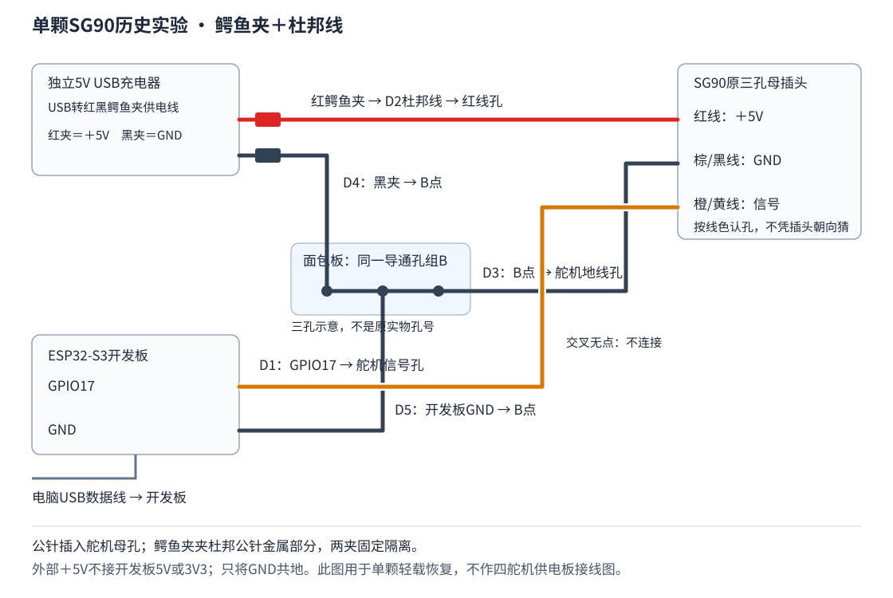

# SG90舵机接线与动作控制实验记录

记录日期：2026-11-02。对应ESP-IDF v5.5.6、小智v2.2.4、Bread Compact WiFi，以及现有ESP32-S3 N16R8开发板。

本文件仅记录此前已经验证的**单颗SG90位置舵机、GPIO17控制、USB鳄鱼夹和杜邦线连接**实验，供拆线后恢复使用。新购器材、采购和机器人四路规划不记在这里。

已确认的是电气连接关系和使用的线材，原面包板具体孔号、每根杜邦线颜色和接头组合没有照片记录。下述逐段接法是按原电气关系整理的可恢复示例，不冒充原桌面的逐孔实拍。

## 1. 快速恢复：信号、电源、共地

SG90通常使用红色电源线、棕色地线、橙色信号线；不同商品可能改用黑色地线或黄色信号线，以具体实物说明为准。

| 端点 | 连接目标 | 作用 |
|---|---|---|
| 舵机信号，常见橙/黄线 | ESP32 GPIO17 | 接收位置控制PWM |
| 舵机正极，红线 | 外部稳压5V正极 | 为电机与舵机内部电路供电 |
| 舵机负极，棕/黑线 | 外部电源负极 | 舵机电流返回路径 |
| ESP32 GND | 外部电源负极的公共地 | 为控制信号提供共同参考 |
| ESP32开发板 | 电脑USB | 开发板独立供电、烧录及日志 |

```text
电脑USB ─────────────────→ ESP32-S3
                              │
                           GPIO17 ───────────→ 舵机信号（橙/黄）
                              │
                             GND ────┐
                                     │
外部稳压5V电源负极 ──────────────── 公共地 ───→ 舵机负极（棕/黑）
外部稳压5V电源正极 ─────────────────────────→ 舵机正极（红）
```

“共地”指外部电源负极、舵机负极、开发板GND互相连通。它不表示把两个电源的正极也接在一起。

**禁止通过开发板3V3给舵机供电。** 本实验也不把外部5V正极接到开发板5V或USB电源上，以免形成未经设计的双电源并联或反向供电。

## 2. 鳄鱼夹、杜邦线和面包板的详细连接

### 2.1 这次恢复需要哪些线

| 标记 | 线材 | 用途 |
|---|---|---|
| USB-A | 电脑到开发板的USB数据线 | 给ESP32供电、烧录和查看日志 |
| USB-B | USB转红黑鳄鱼夹线，插独立5V USB充电器 | 引出舵机电源正负极 |
| D1 | 杜邦线 | GPIO17到舵机信号插孔 |
| D2 | 杜邦线 | 红鳄鱼夹到舵机电源插孔 |
| D3 | 杜邦线 | 舵机地线插孔到面包板公共地点 |
| D4 | 杜邦线 | 黑鳄鱼夹到面包板公共地点 |
| D5 | 杜邦线 | ESP32 GND到面包板公共地点 |

这是一个5根杜邦线的恢复示例；原实物可能用较少导线在夹子处完成分支。原理相同，关键是下文公共地点的三条地线必须导通。

### 2.2 总接线图：两条USB线不能混淆



[单独打开接线图](./鳄鱼夹与杜邦线接线图.svg)。SVG可放大查看；各导线D1～D5与后面的逐根接线表一一对应。

```text
【开发板供电】
电脑 ── USB-A数据线 ── ESP32-S3开发板
                           │
                           ├─ GPIO17 ── D1杜邦线 ────────────────┐
                           │                                    │
                           └─ GND ── D5杜邦线 ──────┐           │
                                                    │           │
【舵机外部供电】                                     │           │
5V USB充电器                                        │           │
   │                                                │           │
   └─ USB-B转鳄鱼夹线                               │           │
          ├─ 红夹（＋5V）── D2杜邦线 ─────────────┐  │           │
          │                                       │  │           │
          └─ 黑夹（GND）── D4杜邦线 ──┐           │  │           │
                                      │           │  │           │
                              面包板公共地点 B    │  │           │
                               ①●──②●──③●        │  │           │
                                │   │    │         │  │           │
                            D4──┘   │    └──D5─────┼──┘           │
                                   D3             │              │
                                    │              │              │
                                    ▼              ▼              ▼
舵机原三孔母插头：                [棕/黑 GND]    [红 ＋5V]    [橙/黄 信号]
                                    │              │              │
                                    └────────── SG90舵机 ──────────┘

B点①②③：同一导通孔组的三个孔，仅为连接示意，不是实物孔号。
文字连线相交不自动代表连接；仅B点①②③为这里指定的公共连接点。
```

为避免长线图产生歧义，按下面三条路径逐一核对，优先以接线表为准：

```text
正极路径：充电器 → USB-B红夹 → D2 → 舵机红线插孔
信号路径：ESP32 GPIO17 → D1 → 舵机橙/黄线插孔
地线汇合：USB-B黑夹 → D4 → B点 ← D3 ← 舵机棕/黑线插孔
                               ↑
                              D5
                               ↑
                           ESP32 GND
```

### 2.3 逐根线接线表

| 线 | 一端 | 另一端 | 检查重点 |
|---|---|---|---|
| D1 | ESP32 GPIO17 | 舵机原插头中对应橙/黄线的孔 | 只传控制信号，不接5V |
| D2 | 红鳄鱼夹夹住杜邦线外露金属公针 | 杜邦线另一公针插入舵机红线孔 | 正极夹子不碰其他外露金属 |
| D3 | 公针插入舵机棕/黑线孔 | 面包板B点孔① | 把舵机负极接入公共地 |
| D4 | 黑鳄鱼夹夹住外露公针 | 面包板B点孔② | 不要只夹住塑料外壳 |
| D5 | ESP32 GND | 面包板B点孔③ | 三者共地，不能遗漏 |

图中B点的孔①②③与表中分配可互换，只要三孔实际导通即可。此处不接开发板5V和3V3，也不接LED或屏幕。

### 2.4 杜邦线选公头还是母头

舵机原三孔插头通常是母头，杜邦线接舵机的一端要用公针。无需拆掉舵机插头，也不需要剪开舵机原线。

如果开发板的排针露在外面，按以下接头组合恢复：

| 线 | 建议接头组合 |
|---|---|
| D1 | 母头接开发板GPIO17公针，公头接舵机信号孔，即公母线 |
| D2 | 两端公针，一端供红夹夹住，一端接舵机红线孔，即公公线 |
| D3 | 两端公针，一端接舵机地线孔，一端插面包板，即公公线 |
| D4 | 两端公针，一端供黑夹夹住，一端插面包板，即公公线 |
| D5 | 母头接开发板GND公针，公头插面包板，即公母线 |

如果开发板已经插在面包板上，则D1、D5的开发板侧也可以使用公针，插入与GPIO17或GND排针连通的空孔。必须先确认这些孔实际连到相应引脚，不能靠“看起来很近”判断。

不要把三根公针插入舵机插头后挤在一起：黑色绝缘套保留到位，仅接触必要金属，插稳后检查没有松动或短接。

### 2.5 公共地点在面包板上如何建立

```text
一个经确认内部导通的五孔组：

      孔①     孔②     孔③     空孔     空孔
       ●───────●───────●───────●───────●
       │       │       │
      D3      D4      D5
       │       │       │
   舵机GND  电源黑夹  ESP32 GND
```

普通面包板常为同一侧五孔横向连通，中间沟槽两侧不连通；不同面包板方向和布局可能不同。先断电，用万用表通断挡确认三孔属于同一孔组。也可以用已经确认导通的负电源轨，但不要假设电源轨跨中间断点也导通。

这只是原单颗SG90轻载学习接法，不应把面包板和细杜邦线当成后续多颗承重舵机的公共供电干线。

### 2.6 鳄鱼夹怎么夹才算连接

- 夹住D2、D4外露公针的金属部分，不是夹黑色塑料套。
- 两个夹子固定在互不接触的位置，外露金属之间保留距离，必要时用绝缘套或胶带隔开。
- 鳄鱼夹不需要直接去夹舵机原插头内部的铜片；用杜邦公针引出来更容易检查。
- 杜邦线颜色本身不决定正负极。若D2不是红线，仍以它实际接到红夹这一事实为准，并贴标签。
- 原USB充电器和夹线能完成一次动作，不代表适合堵转或长时间承重；若接头发热、动作抖动或供电降压，先断电查接触和供电。

### 2.7 通电前怎样测量

先在两侧均断电时检查B点共地是否导通，并检查正极与地之间没有接线短路。若舵机仍连接，内部电路可能影响通断读数，需要拔开负载判断，不要把所有蜂鸣都直接认作短路。

测电源电压时，暂时不连接舵机，只接充电器和夹线；确保红黑夹分别固定。万用表使用直流电压挡，黑表笔接COM、红表笔接V孔，红表笔测红夹、黑表笔测黑夹，应读到约正5V。确认后再次断电，再完成舵机接线。不要用电流挡跨接两夹，不要带电使用通断挡。

## 3. 断电搭建与首次恢复

1. 拔掉开发板USB和外部电源。
2. 舵机先不承重，输出轴周围留出空间；需要安装摇臂时先完成回中。
3. 接好舵机红线到外部5V正极，棕/黑线到外部负极。
4. 用公共地连接外部负极和开发板GND。舵机主电流通过外部供电线返回，不要经开发板或细共地跳线绕路。
5. 最后确认GPIO17接的是信号线，信号线没有误接5V。
6. 上电时确保两侧地线已可靠连接。当前程序初始化会输出1500μs中位脉冲，舵机可能立即移动。
7. 先验证中位，再小幅测试80°和100°；确认方向和无卡顿后再试60°、120°及摇头。
8. 若机械顶死、明显持续嗡鸣、发热或电源异常，立即断开舵机外部电源，检查范围和负载。

不要在带电保持位置时用手强扭摇臂。接线和安装调整时同时断开两侧电源，避免外部断电但信号仍在输出的状态。

## 4. 当前源码与资源

| 文件 | 当前职责 |
|---|---|
| [`compact_wifi_board.cc`](../../../main/boards/bread-compact-wifi/compact_wifi_board.cc) | `InitializeTools()`中构造`static ServoController servo(GPIO_NUM_17)` |
| [`servo_controller.h`](../../../main/boards/common/servo_controller.h) | 舵机PWM、任务、队列及MCP工具 |
| [`application.cc`](../../../main/application.cc) | `[MCP RX]`云端消息日志 |
| [`mcp_server.cc`](../../../main/mcp_server.cc) | 工具调用参数、回调执行与结果日志 |

| 参数 | 当前源码值 |
|---|---|
| 信号脚 | GPIO17 |
| LEDC模式 | `LEDC_LOW_SPEED_MODE` |
| 定时器 | `LEDC_TIMER_3` |
| 通道 | `LEDC_CHANNEL_3` |
| PWM频率 | 50Hz |
| PWM周期 | 20000μs，即20ms |
| 分辨率 | 14位；每周期16384个计数位置 |
| 初始化脉宽 | 1500μs，中位指令 |
| 线性映射参考 | 0～180°对应500～2500μs |
| 软件允许范围 | 10～170° |
| 摇头目标序列 | 90 → 60 → 120 → 90，循环 |
| 任务名称/栈/优先级 | `servo_motion` / 4096字节 / 2 |
| 队列长度 | 1，使用`xQueueOverwrite()`覆盖待处理指令 |

LED使用定时器2、通道2、5kHz，与舵机分开。**当前舵机类固定使用通道3，不能直接构造四个对象控制四颗MG90S**：通道会冲突，MCP工具名也会重复，需先做多路设计。

## 5. PWM为何能控制位置

位置舵机根据一段重复脉冲中的高电平宽度理解目标位置，而不是单纯根据PWM百分比理解“转速”。当前每20ms重复一轮，脉宽按目标角度换算。

```text
一个周期约20ms：

高电平 ┌─────┐                         ┌─────┐
低电平 ┘     └─────────────────────────┘     └──
        脉宽          剩余低电平

90°参考：高电平1500μs，周期20000μs，占空比约7.5%
```

当前换算：

```text
pulse_us = 500 + angle × (2500 − 500) ÷ 180
duty = pulse_us × 16384 ÷ 20000
```

两步均使用整数运算，会截去小数：

| 软件角度 | 脉宽（μs） | LEDC计数duty |
|---|---:|---:|
| 10° | 611 | 500 |
| 60° | 1166 | 955 |
| 90° | 1500 | 1228 |
| 120° | 1833 | 1501 |
| 170° | 2388 | 1956 |

这些是**代码输出的估算角度**，不是实测机械角度。500～2500μs也不是每一颗SG90或MG90S都能安全达到的通用行程。软件限制10～170°只是当前实验设置，不是实物安全证明；换舵机后应重新从中位和小范围校准。

普通三线SG90内部有位置控制，但不会通过这三根线把实际角度回传ESP32。代码中的`current`记录最近输出的指令角度，无法判断受阻、负载过大或齿轮打滑后是否真正到位。

## 6. FreeRTOS任务与单格队列

控制链路如下：

```text
语音请求 → 云端选择MCP工具 → 本地回调
                                    ↓
                              写入单格指令队列
                                    ↓
                              servo_motion任务
                                    ↓
                              更新GPIO17的PWM
```

回调不执行完整的一轮摇头，只发送指令。独立任务负责逐步移动和读取新命令，因此长动作不会要求回调一直等待。

- 静止时用`portMAX_DELAY`等待队列消息。
- 移动时队列接收超时约20ms；没有新消息时，指令角度最多向目标推进2°，再更新PWM。
- 若收到消息，先处理指令并进入下一轮循环。新命令可以打断后续动作，不必等待摇头整轮结束。
- 由于调度、消息和队列等待会影响更新时间，“20ms一步”是名义行为，不是严格实时保证；也不能据此断言机械轴每20ms恰好移动2°。
- 单格队列中尚未处理的旧命令会被新命令覆盖，不是多条动作依次排队。例如很快连发开始与停止，开始可能尚未执行就被停止替代。

## 7. MCP接口与实际行为

| MCP工具 | 参数 | 行为 |
|---|---|---|
| `self.servo.set_angle` | `angle`，10～170整数 | 取消摇头，逐步移动至绝对目标角度 |
| `self.servo.start_shake` | 无 | 循环90→60→120→90；已经摇头时忽略重复开始 |
| `self.servo.stop` | 无 | 取消后续动作，目标设为最后输出的指令角度，不自动回中 |

设置角度参数示例：

```json
{"angle":90}
```

可尝试的语音表达：“舵机转到90度”“开始摇头”“停止动作”。语音识别和云端工具选择不保证固定映射，必须以实际`self.servo.*`调用日志为准。

`set_angle`表示绝对目标，不表示在现有位置基础上再转这么多度。底层`SetAngle()`另有范围钳制，但工具接口本身也声明了10～170范围，超界参数可能在工具校验阶段被拒绝。

**停止动作不等于断电或卸力。** 停止后PWM继续输出，舵机可能继续保持位置和消耗电流；如果它尚未机械到位，还可能继续追向最后给出的指令位置。需要切断力矩时，本实验的办法是断开外部舵机电源，当前没有软件卸力接口。

三个工具的成功返回只说明回调和发送指令路径成功，不表示目标位置已经达到，更不是实物角度反馈。

## 8. 如何阅读日志

| 标记 | 意义 |
|---|---|
| `[MCP RX]` | 收到云端MCP内容 |
| `[TOOL CALL]` | 调用编号、工具名称和参数 |
| `[TOOL EXEC]` | 本地回调开始执行 |
| `[QUEUE SEND]` | 准备写入舵机指令队列 |
| `[TOOL RESULT]` | 回调返回；不表示动作完成 |
| `[TASK READY]` | 舵机任务启动，初始指令角度90° |
| `[QUEUE RECV]` | 任务接收指令 |
| `[MOVE]` | 取消摇头并设定目标 |
| `[SHAKE START]` | 开始循环或忽略重复开始 |
| `[SHAKE NEXT]` | 到达一个指令目标，切换下一个目标 |
| `[STOP]` | 取消后续动作，保持最后指令角度，PWM继续输出 |

逐步脉宽及duty日志位于`ESP_LOGD`的DEBUG级别，默认INFO日志看不到是正常的。没有必要为了证明任务在运行而始终输出每一步日志。

任务调度可能让`[QUEUE RECV]`与`[TOOL RESULT]`的先后次序变化；`[QUEUE SEND]`在实际写队列之前打印，用于帮助理解异步执行。即使看到`[SHAKE NEXT]`，也只能说明软件指令已推进到该值，不能证明实物到位。

## 9. 排查表

| 现象 | 优先检查 |
|---|---|
| 上电转一下 | 当前构造函数立即输出1500μs中位脉冲，属于预期行为 |
| 工具成功但完全不动 | 外部5V是否存在；信号线是否接GPIO17；共地是否可靠；是否买到连续旋转款 |
| 发出语音却没有舵机日志 | 先看云端是否调用正确的`self.servo.*`工具 |
| 抖动、无力、动作中断 | 舵机端电压与压降、鳄鱼夹接触、细线、外部电源保护及机械负载 |
| 停止后仍有保持力或嗡声 | PWM仍输出；同时检查是否受阻或负载过大 |
| 停止后没有回90° | 正常，停止保持最后指令；回中需另设90° |
| 连续发几个角度，中间角度没执行 | 单格队列覆盖待处理命令，符合当前设计 |
| 接上四颗后只有一颗能控或互相干扰 | 当前类只适合单颗，固定LEDC通道和工具名不可直接复用四份 |
| 动作范围不对、碰到极限 | 立即停止并断电，重新校准脉宽、方向和机构范围 |
| 开发板重启、音频异常 | 检查供电耦合、共地路径、线材布局；不要把舵机主电流经开发板走线 |

## 10. 拆线与恢复范围

拆线时同时断开USB与外部电源，再移除GPIO17信号、舵机正负极和仅供舵机使用的共地支线，保留其他模块的公共GND。

仅拆硬件不改变源码：工具仍注册，GPIO17仍可能输出PWM。恢复其他功能时先核对GPIO17和LEDC定时器3、通道3是否已被重新分配。

本文件只维护这颗SG90实验。后续多路接线板、其他型号和独立电源验证应另建记录，不在本文件追加采购或多路接线方案。

本次仅核对源码并编写历史记录，没有变更固件或做新的实物测试。

待补记：原SG90实测尺寸与行程、原充电器铭牌、实际供电电流、原面包板孔位和接线照片。
