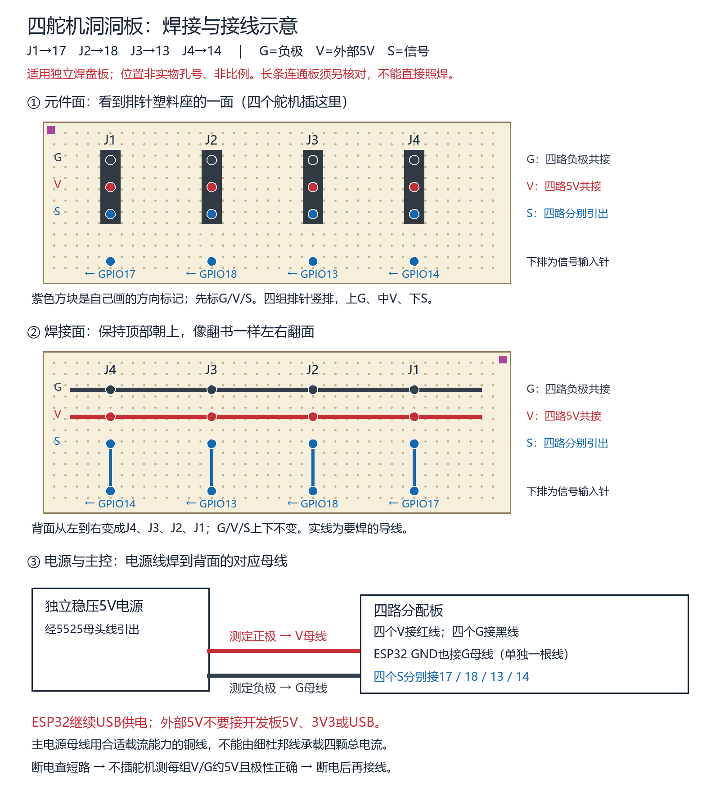

# 四舵机分配板焊接与接线

2026-11-05最新用户反馈：60～120度语音控制测试“都可以了”，记录为该空载范围获实物反馈；不推定实际角度校准、量化供电或机械负载通过。下一步按用户要求进入[A1舵机与摇臂实测](../../project/four-servo-biped/mechanical/A1舵机与摇臂实测清单.md)，本轮不改固件。下文“新范围尚未实测”保留为当时历史状态。

## 2026-11-05语音通过后扩大角度范围（当前）

用户确认语音控制正常，要求角度扩大一点继续测试。本轮将`four_servo_controller.h`中的上下限由80～100改为60～120度，单路与全部角度工具共用限制；同时更新工具描述和越界提示。90度仍为估算中位，线性映射不变：60/90/120度分别对应1166/1500/1833微秒指令（整数截断，PWM还有量化误差），实际机械角度仍未校准。

四路控制开关保持1，开机自检与旧实验开关均0；仍需语音MCP明确调用才输出，启动不自动动作。用户反馈仅证明上一版语音功能可用，不代表60～120新范围已实测或可以装载机构运行。

新版烧录后保持空载，先单颗由90→80→70→60，再回90→100→110→120，每次等停稳、观察无异响或顶住再继续；逐颗确认后再用“把四个舵机一起转到60度/120度”测试共同角度，避免首次直接跨全范围。语音编号仍为1～4，对应GPIO17/18/13/14。日志仍看`[SET]`及`[SET ALL]`，状态记录最后软件指令，不是传感器角度。异常直接断外部5V，结束释放全部并关闭外部电源。

回退只需将上下限、MCP描述和提示恢复80～100后重新编译烧录。新范围尚未烧录或实物验收，下文80～100为历史记录。

本轮检查：2026-11-05，ESP-IDF v5.5.6下`idf.py build`通过，应用分区余量34%；`git diff --check`通过。已核对单路/全部MCP参数与底层限制均为60～120度，未烧录或执行扩大范围的实物测试。

## 2026-11-05同时动作确认后启用语音控制（已获用户反馈）

用户反馈四颗同时动作也正常，记录为四路共同小幅空载动作获实物确认，不推定电流/压降量化、长期稳定性、机械承重或行走通过。按最新要求关闭全部开机自动测试，启用四路MCP语音控制。

当前`BREAD_COMPACT_ENABLE_FOUR_SERVOS=1`，`BREAD_COMPACT_ENABLE_FOUR_SERVO_SELF_TEST=0`、`BREAD_COMPACT_ENABLE_SERVO17_SELF_TEST=0`，旧灯/单SG90均0。开机只初始化四路零占空比，不创建自动动作任务、不回中；收到明确角度工具调用后才输出。自检源码保留，重新开启须关闭正常控制入口并重新构建烧录。

| 语音示例 | 工具与参数 | 结果 |
| --- | --- | --- |
| 把1号舵机转到80度 | `self.servos.set_angle`，`servo=1, angle=80` | 只修改J1，其他路保持原状；可用1～4号 |
| 四个舵机一起转到100度 | `self.servos.set_all_angles`，`angle=100` | 四路共同输出同一角度指令，不自动往返 |
| 四个舵机全部回中 | `self.servos.set_all_angles`，`angle=90` | 暂定中位，持续输出脉冲保持指令 |
| 释放2号舵机 | `self.servos.release`，`servo=2` | 指定路占空比归零 |
| 释放全部四个舵机 | `self.servos.release`，`servo=0` | 四路占空比归零，不切电 |
| 查询四个舵机状态 | `self.servos.get_state`，无参数 | GPIO、PWM启用状态与最后指令角度，非实际位置 |

角度仍限定80～100，暂不扩大行程；共同角度先写四路再紧邻更新，与刚才同时测试的更新方式一致，不保证硬件同沿或机械速度相同。释放不保证保持位置或解除堵转；异常应物理断外部5V。

烧录时关闭外部舵机电源，准备好接线和空载环境后再供电。新版启动应只见`FourServo [READY]`四路，不应再见自动`FourServoTest [STEP]`。先查询状态，再分别测试单路和全部角度，最后释放全部。控制日志单路为`[SET] J编号 GPIO编号`，共同为`[SET ALL]`，释放为`[RELEASE]`；若只有语音回复而没有工具日志，先查云端MCP调用，不能直接归因硬件。语音路径仍待新版烧录验收。

本轮检查：2026-11-05，ESP-IDF v5.5.6下`idf.py build`通过，应用分区余量34%；`git diff --check`通过，未烧录或执行实物语音控制。

## 2026-11-05四路开机同时动作测试（已获用户反馈）

用户明确反馈四个舵机均能正常依次动作，记录为上一版逐路空载自检获实物确认；不代表同时启动电流、负载能力或机械动作已验收。按用户要求继续保持开机自动、暂不用舵机语音控制，改为四路一起输出同一组小幅动作。

- 配置仍为`BREAD_COMPACT_ENABLE_FOUR_SERVO_SELF_TEST=1`，四路MCP、GPIO17单路自检及旧实验均关闭；代码在`four_servo_self_test.h`，引脚和PWM资源不变。
- 启动初始无脉冲，独立任务等待5秒后，四路共同执行1500→1400→1500→1600→1500微秒，每步保持2秒。约15秒完成一轮后四路全部归零并删除任务，不循环，复位重跑。
- 每一步先写入四路占空比再紧邻更新输出，无路间等待；这是共同动作测试，不保证四个硬件通道在完全相同的边沿更新，也不保证四个舵机实际速度、方向与角度一致。脉宽/计数是软件指令，不是物理波形测量。
- 日志标签`FourServoTest`保持不变：`[READY]`四路、`[WAIT]`、一条四路`[BEGIN]`、共同的五条`[STEP]`、四条`[RELEASE]`、最后`[DONE]`。

操作：外部5V关闭时烧录，全部断电接线；四颗保持空载，USB与外部5V准备好后按RESET/RST，等待一轮自动动作。首次同时动作重点看四颗是否都响应，以及是否出现持续嗡响、异常发热、ESP32重启、屏幕闪烁或语音异常；异常立即断外部5V。逐路通过不代表同时动作供电余量已足够，当前没有新增电流或压降测量。结束后停止脉冲仍未切电，测试后关闭外部5V；换线全部断电。

当前同时动作新版尚未烧录或实物确认。下文依次动作的45秒时序为上一版历史记录，不再适用于当前代码。

本轮检查：2026-11-05，ESP-IDF v5.5.6下`idf.py build`通过，应用分区余量35%；`git diff --check`通过。仅软件检查完成，未烧录、未测同时动作电流/压降或联合稳定性。

## 2026-11-05四路开机依次自动测试（已获用户反馈）

用户要求四路沿用GPIO17自检方式，开机自动依次测试，暂不使用舵机语音控制。本轮新增板级`four_servo_self_test.h`，覆盖下文恢复MCP控制的配置。

- 当前`BREAD_COMPACT_ENABLE_FOUR_SERVO_SELF_TEST=1`，四路MCP开关`BREAD_COMPACT_ENABLE_FOUR_SERVOS=0`，GPIO17单路自检与旧实验开关均0。新增编译保护禁止自检与其他舵机/旧灯入口同时启用。舵机MCP工具不注册，原语音对话和屏幕工具仍保留。
- 初始化J1/GPIO17、J2/GPIO18、J3/GPIO13、J4/GPIO14为零占空比，LEDC通道1～4共用定时器3，50Hz/14位，避开背光0/0。
- 开始等待5秒，再按J1→J2→J3→J4各执行1500→1400→1500→1600→1500微秒，每步停2秒。每路10秒，测完先将该路占空比归零再测下一路；任一时刻仅一路发送脉冲，其他路不发送脉冲。无额外路间等待，总计约45秒后全部归零，任务自删，不循环，每次复位会重跑。
- 暂定1500微秒中位和±100微秒小幅动作，与已获用户反馈的单口自检一致；真实角度、方向与物理波形未量化验证。已测舵机不持续输出保持脉冲，不适用于站立或承重测试；停止脉冲不切电。

操作：关闭外部5V进行烧录；全部断电时接齐四颗并保持空载。USB启动主控、接通已核对的外部5V后，按RESET/RST复位键，使5秒等待从准备好供电之后开始。观察J1约第5～15秒、J2约15～25秒、J3约25～35秒、J4约35～45秒小幅往返。时间是测试任务的名义时序，不含前置启动时间或调度延迟。串口应依次有`FourServoTest`的`[READY]`、`[WAIT]`、各路`[BEGIN]`、五条`[STEP]`、`[RELEASE]`，最后`[DONE]`。

全程不需要语音或联网；换线、拔插或交换舵机前全部断电。持续嗡响、发热、顶住或主控重启时直接断外部5V。某路无动作时记录该路编号、GPIO与对应日志；日志只能证明程序执行，不能直接判定硬件故障。四路完成后应关闭外部5V。

回退：关闭四路自检开关，按需要单独恢复四路MCP开关或GPIO17自检开关，再构建烧录；不能同时开启。这是开机自动动作的临时台架固件，后续改动不得误当成默认静止版。

本轮检查：2026-11-05，ESP-IDF v5.5.6下`idf.py build`通过，应用分区余量35%；`git diff --check`通过。已核对测试时序与PWM通道避开背光，未烧录、未实测四路波形或动作。

## 2026-11-05自检反馈后恢复四路控制

用户反馈GPIO17自检“可以了”，要求继续四路控制。记录为本地自检已有动作反馈，未进一步确认是否已轮换完四颗，不推定GPIO18/13/14及四颗联合供电均通过。

当前配置恢复`BREAD_COMPACT_ENABLE_FOUR_SERVOS=1`，关闭`BREAD_COMPACT_ENABLE_SERVO17_SELF_TEST=0`；GPIO17自动启动动作取消，旧灯/单SG90继续关闭。保留自检源码供以后排障，不能与四路入口同时启用。四路控制使用下文已有MCP接口与80～100度小幅范围，上电占空比为0，等待明确指令；本次不扩大行程或增加步态。

重新烧录后，将四颗在全部断电时接回J1～J4（GPIO17/18/13/14）。先说“查询四个舵机状态”，查看各路GPIO与`pwm_enabled=false`；再分别对1、2、3、4号逐个发90→80→100→90度指令，每次停稳再继续。每路测试后可释放该路，最后释放全部；日志应有对应`FourServo [SET] J编号 GPIO编号`。如果语音回复但没有SET日志，先核对MCP是否调用，而不是直接判断舵机或GPIO损坏。

本次修改完成后仍需用户烧录新版并实屏/实物验证；旧自检固件在新烧录前仍会重启动作。

本次恢复检查：2026-11-05，ESP-IDF v5.5.6下`idf.py build`通过，应用分区余量35%；`git diff --check`通过，未烧录或驱动硬件。

## 2026-11-05仅GPIO17本地自检

用户反馈四颗均无动作，现只在GPIO17接一颗，要求同一接口轮换四颗排查。尚不能判断是舵机、电源、线束、GPIO输出还是MCP未调用；此前四路动作未验收。本次临时改为脱离联网/语音/MCP的启动自检，覆盖下文四路默认启用的历史状态。

- `config.h`：`BREAD_COMPACT_ENABLE_FOUR_SERVOS=0`、`BREAD_COMPACT_ENABLE_SERVO17_SELF_TEST=1`，旧灯与单SG90仍为0；编译保护禁止这些入口与自检同时启用。
- 新入口`servo17_self_test.h`由板级`InitializeTools()`静态初始化，仅GPIO17、LEDC定时器3/通道3、50Hz、14位；GPIO18/13/14不被舵机代码初始化，LCD背光仍使用0/0。
- 启动初始占空比0，独立任务等待5秒，然后依次输出1500→1400→1500→1600→1500微秒指令，各保持2秒；约15秒结束、占空比归零、任务自删。没有自动循环，不需要说话或联网，复位后重跑。
- 1500微秒作为暂定中位，±100微秒为两侧小幅测试；方向和真实角度仍待实测。14位占空比有量化误差，日志记录脉宽指令及计数，不代表测得物理波形。首次可能从未知位置直接转到中位。

### 轮换四颗的操作

1. 舵机保持空载，GPIO17接信号，红线接外部5V，棕/黑线接电源负极，ESP32 GND与其共地。先关外部5V烧录固件。
2. 断电插好一颗后，用USB启动主控、接通已核对极性的外部5V，再按开发板RESET/RST复位键重跑（不是BOOT键），确保本轮5秒等待前供电已准备好。
3. 看约10秒的一轮小幅往返；日志应有`Servo17Test: [READY]`、`[WAIT]`、`[STEP 1/5]`至`[STEP 5/5]`和`[DONE]`。结束后停止脉冲，但舵机电源仍通，不能把结束当成物理断电。
4. 关闭外部电源并拔USB，再换下一颗到同一GPIO17接口；重复步骤2～3。不要带电插拔，不装负载或手动顶住转轴；可用空载摇臂或轴上标记帮助观察小幅动作。
5. 若持续嗡响、发热或顶住，立即切外部电源。四颗都不动时，把启动到DONE日志发来，先核对新固件确实执行，再用直流电压档测舵机插头V/G实际供电、断电查共地与信号线导通。万用表直流读数不能证明50Hz脉宽正确；需要示波器/逻辑分析仪才能核实波形。正常日志也不能证明舵机损坏或输出脚完好。

本地自检为临时固件，每次重启都会再次动作；排障结束须将自检开关改为0，恢复四路开关1并重新构建烧录。当前仅编写与构建，不主动烧录或远程触发实物。

2026-11-05检查结果：ESP-IDF v5.5.6环境下`idf.py build`通过，生成`build/xiaozhi.bin`，应用分区余量35%；`git diff --check`通过。未烧录、未实测GPIO17波形或四颗舵机状态。

## 2026-11-03四路控制与首轮测试

用户反馈线已接好，授权加入四路独立控制。接线完成为用户反馈，不代表已测通断、电压、极性或动作通过。以下新实现覆盖下文历史“尚未实现四路固件”的状态；尚未烧录和实机测试。

- 入口：`main/boards/bread-compact-wifi/four_servo_controller.h`，板级`InitializeTools()`静态持有；`config.h`中`BREAD_COMPACT_ENABLE_FOUR_SERVOS=1`，设为0可关闭新入口。
- J1～J4依次为GPIO17/18/13/14，使用LEDC通道1/2/3/4，共用定时器3，50Hz、14位；LCD背光保持通道0/定时器0。旧灯与单SG90开关保持0，误同时开启会编译报错。
- 启动四路占空比均为0，不发送控制脉冲、不自动回中。只有明确设置指定接口才启用该路，其余路不改变；不增加运动任务或阻塞等待，用互斥锁串行保护PWM和状态。
- 首轮角度限定80～100，90对应1500微秒；暂按500～2500微秒映射估算，实际角度、方向和本批MG90S适用范围仍待校准。该范围用于空载测试，不保证任何机械安装下都安全。首次指令可能直接从未知位置转到目标，不承诺平滑启动。

### MCP工具与可复现指令

| 工具 | 参数 | 行为 |
| --- | --- | --- |
| `self.servos.get_state` | 无 | 返回各路GPIO、PWM启用状态、最后指令角度；尚未控制为null，不是位置传感器读数 |
| `self.servos.set_angle` | `servo`为1～4；`angle`为80～100 | 指定一路输出并保持该指令，其他路保持原状 |
| `self.servos.release` | `servo`为1～4；0表示全部 | 指定路占空比归零、不再发送脉冲；不切电、不保证保持位置，也不保证解除堵转 |

语音可说“查询四个舵机状态”“把1号舵机设为90度”“把1号舵机设为80度”“把1号舵机设为100度”“释放全部四个舵机”。云端是否正确调用须看MCP日志，不把助手口头回复视为动作验证。精确参数示例：`self.servos.set_angle {"servo":1,"angle":90}`；释放全部为`self.servos.release {"servo":0}`。

### 按这个顺序实物测试

1. 外部舵机电源断开，完成通断和极性检查；电压档确认各接口约5V且无反接后再次断电。舵机不装承重结构，轴和摇臂活动范围留空。不要带电拔插。
2. 保持外部5V关闭，编译并通过正确串口烧录新固件，ESP32用USB启动。应看到四条`[FourServo] [READY]`（串口实际格式由ESP-IDF决定），各路启动无脉冲。查询状态应为四路`pwm_enabled=false`、角度null。只看日志不能证明物理波形正确。
3. 首次只插J1的一颗舵机（断电插拔），先USB启动再接外部5V，调用1号90度；有可能立即转动。确认对应J1转动、其他路无误动作，再逐次调用80→90→100→90，每次等目视停稳后再发下一条，不连发。
4. 日志应出现`[SET] J1 GPIO17`及对应指令角度。观察无顶限位、持续嗡响、异常发热、重启或屏幕/音频异常，再释放1号。释放不等于电源急停，异常时直接断舵机电源。
5. 全部断电后，将同一颗已验证舵机依次接J2/J3/J4，分别按2/3/4号重复，验证接口和信号线；再将四颗逐颗接入测试，区分舵机故障与板上接口问题。
6. 单路全部通过后，才四颗同时接上，依次把1～4号设90度，先检查共同保持时的供电与主控稳定性，再每次只动一路80～100度。暂不自动齐动、不测试站立/慢走、不扫0～180度。
7. 测试结束调用释放全部，再关外部5V。PWM关闭期间仍可能存在舵机自身的上电抖动或保持行为；无PWM不等于物理断电或安全急停。

每路记录：接口、GPIO、舵机编号、90/80/100动作方向、异响/发热、是否影响屏幕/语音、若有测量则记录电压。仍需实物验证后才能写为通过。

2026-11-03检查：ESP-IDF v5.5.6下`idf.py build`通过，生成`build/xiaozhi.bin`，应用分区余量35%；`git diff --check`通过。已核对当前背光占用0/0、新四路使用1～4/3及旧入口关闭，未烧录、未验证实际波形、动作、电流或音频/显示联合稳定性。

2026-11-02：用户确认LCD首版功能已完成，恢复四舵机阶段，先制作独立接线板。本记录为施工方案，尚未确认到货、焊接或通电结果；随后按用户授权屏蔽旧LED及单SG90固件入口，尚未实现四路输出、未驱动硬件。

## 本轮范围

用洞洞板、公排针和独立5 V电源制作四路舵机供电与信号分配板。板上不需要第二颗主控，ESP32输出控制信号；它不是已制作的定制PCB。先将四个接口命名为J1～J4，暂不绑定左右腿脚，避免机械布局尚未确定时接反动作。

历史记录已购四颗MG90S、洞洞板、公排针、5V5A电源及5525母头线，实际到货、线径、接口载流能力与电源极性仍须核对。洞洞板正反面、独立焊盘或连通条类型未确认，不指定实物孔号。

## 电气连接

2026-11-02本轮信号分配确定为J1→GPIO17、J2→GPIO18、J3→GPIO13、J4→GPIO14，取代此前GPIO8候选；GPIO8保留备用。分配依据是当前板级源码与旧实验入口已默认关闭，接线前仍须核对实物引出和其他接线。



图中四组1×3排针供舵机插入，下方四个单针供ESP32信号接入；这四个输入针分别在背面连到对应S脚。也可不用输入单针，直接将信号导线焊到对应S脚。电源输入线与ESP32共地线直接焊到对应母线，并做应力固定；它们不经过信号输入针。紫色方块为自行画的方向记号，左右翻面后记号从左上移到右上，不能上下颠倒后照图。

这是独立焊盘洞洞板的连接关系图，不是实际孔号或比例图；每组G/V/S必须用连续三针，不能按图形间距跳孔安装三针插头。长条连通板或其他连通方式须先核对，未核对时不要照焊。四组之间留出插头空间。可用[绘图脚本](./draw_wiring.py)重建图片，脚本需Python、Pillow和Windows微软雅黑字体。

```text
电脑USB ── ESP32（保留现有LCD、麦克风、功放）
              GPIO17 ───────────────────── J1 S
              GPIO18 ───────────────────── J2 S
              GPIO13 ───────────────────── J3 S
              GPIO14 ───────────────────── J4 S
              GND ───────┐
                         │ 单独共地支线
外部稳压5V负极 ──────────● GND分配点 ── 各接口G
外部稳压5V正极 ──────────● +5V分配点 ── 各接口V
```

外部5V不连接ESP32的5V、3V3或USB电源。舵机负载电流从外部电源经分配板到舵机，再直接回到外部电源；不要串经ESP32或面包板电源轨。

四个舵机接口统一采用三针，建议从同一观察方向标为`G / V / S`。G为负极，V为外部5V，S为独立信号。舵机常见棕/黑为G、红为V、橙/黄为S，但必须检查实物，不能只按颜色或插头朝向判断。

| 接口 | G | V | 本轮信号分配 |
| --- | --- | --- | --- |
| J1 | GND分配点 | 外部5V | GPIO17 |
| J2 | GND分配点 | 外部5V | GPIO18 |
| J3 | GND分配点 | 外部5V | GPIO13 |
| J4 | GND分配点 | 外部5V | GPIO14 |

信号GPIO已核对当前板级源码，接线前仍需核对开发板实物丝印和是否另有占用。GPIO编号不是排针从头数的第几个脚。先预留信号接口，四路固件完成前不要把焊好板理解为四路已经可控。

## 推荐布置与焊接顺序

1. 全部断电，拔下电脑USB和外部电源，四颗舵机先不插。确认洞洞板焊盘连通方式；独立焊盘之间不会自动连接。
2. 四组1×3公排针平行摆放，均保持同一G/V/S顺序；插头应有插拔空间，电源输入放在板边。先在元件面标注J1～J4及G/V/S，再翻面焊接，注意背面左右会镜像。
3. 每组先焊一脚、检查垂直后焊其余脚。焊点同时润湿引脚和焊盘，避免连锡；不要用大块焊锡代替主电源导线。
4. 在板背用合适的绝缘铜线建立+5V与GND两个分配点，分别向四组V脚、G脚分支。主供电和共同回路要按总负载、长度、接头能力选线，不用单根细杜邦线承担四颗总电流；线材不明时先核对，不能凭5A电源铭牌认定线束也能承受5A。
5. 四组S脚分别接四个独立信号输入端，绝不能互相并联。另留一个ESP32 GND接入端，接到GND分配点。
6. 5525母头线先用万用表核对触点与线端对应关系、测电源实际极性；不默认红黑线一定正确，也不默认所有适配器中心为正。确认后再接入+5V/GND。线缆在板边固定并绝缘，避免拉扯焊点。
7. 如增加舵机断电开关，应串在外部5V正极主路，开关和连接器需具备足够的直流载流能力；保留共地。当前未确认有合适开关，不把小信号开关直接当四舵机电源开关。

总线实际线径、是否增加保险及去耦电容，在电源、线材和舵机实物确认后确定；本方案不宣称已有完整过流或反接保护。需要电解电容时必须确认极性与耐压，不能靠电容弥补过细线束。

## 通电前后检查

断电、无舵机、无ESP32连接时：

- 四个V脚都与电源正极导通；四个G脚和共地端都与电源负极导通。
- +5V与GND之间没有短路；各S脚之间、S与V/G之间没有意外导通。
- 用目视和万用表一起排查连锡、散铜丝和接反。通断档只在断电时使用。

仅接外部电源、仍不插ESP32与舵机：万用表置直流电压档，黑表笔接G、红表笔接V，逐个接口测得正确极性与约5V后再断电。不要用电流档跨接V/G。

首次动作只接一颗、空载测试，不装腿脚、不扫全行程；确认本批舵机允许5V及3.3V控制信号。旧GPIO17控制器启动会发送90度指令；本次已默认屏蔽其入口，但设备未烧录新固件前仍可能执行旧行为。后续先用适合本批次的中位及小幅动作确认，再逐颗增加，最后做四路联合测试；若持续嗡响、顶住限位、导线发热或主控重启，立即断开舵机电源排查。

## 固件边界与下一步

当前保留`main/boards/common/servo_controller.h`和`lamp_controller.h`公共源码。本板`config.h`新增`BREAD_COMPACT_ENABLE_LEGACY_LAMP=0`和`BREAD_COMPACT_ENABLE_LEGACY_SERVO=0`，条件屏蔽头文件和实例化入口，因此不初始化旧GPIO/PWM、不注册旧灯/舵机MCP工具、不创建旧单舵机任务。GPIO18/17不再由旧实验占用，本轮分配给J2/J1；四路信号分配已记录，但尚未写入四路控制固件，不能同时开启旧实验入口。

旧LED使用定时器2/通道2，旧舵机使用50Hz定时器3/通道3，关闭入口后可重新规划其资源。LCD背光定时器0/通道0仍保留；旧文档四路候选含通道0，不能原样照搬。恢复任一旧实验开关前须核对新接线和资源冲突。本次不实现四轴输出，不修改公共控制器或其他板型。

下一步先核对洞洞板正反面、电源铭牌及输出头、5525母头线、舵机插头和可用线材，再按实物画孔位图。硬件接线检查通过后再开发四路独立控制、校准方向与中位，机械与步态后续分阶段推进。

## 本次检查结果

2026-11-02：关闭旧LED/单SG90入口后，ESP-IDF v5.5.6环境下`idf.py build`通过，`git diff --check`通过；未烧录、未进行实物验证。设备仍运行原固件，直到后续烧录更新。

同日补充：绘制并目视检查本轮信号分配及正反面镜像接线图；本轮仅更新文档及绘图源，不更改固件，不重复构建，不代表焊接或实物验证完成。
