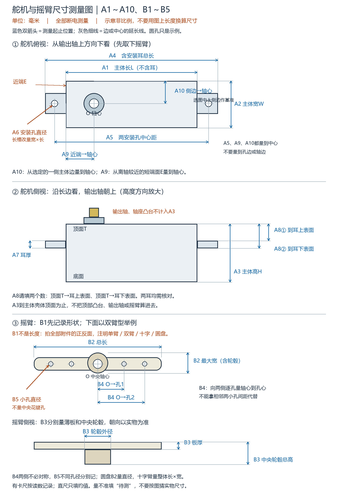

# A1舵机与摇臂实测清单

日期：2026-11-05。用户已确认四颗依次、共同、语音控制及60～120度空载测试正常；本次进入现有A1接口实物核对，不修改固件、不扩大动作、不打印放行。

## 测量位置图



图分为舵机俯视、舵机侧视、摇臂俯视与侧视，蓝色双箭头表示测量两端，灰色为尺寸界线。A8需要顶面到耳片上下表面两个数；B1是附件形状记录，不是长度。B3分别量板厚、轮毂外径和中央总高。图中摇臂仅以双臂型举例，其他形状逐孔记录，不假设对称。孔径A6/B5用引线指出位置，圆孔量直径、长孔量宽长，不量中心花键孔。

此图为无标称数值的测量基准示意，不按真实比例绘制，不可根据图上像素换算实物尺寸。[绘图源](./draw_measurement_guide.py)使用Python/Pillow与Windows微软雅黑字体重建；图片已目视核对A1～A10、B1～B5标注及测量基准，未填实测数据。2026-11-05文档/图片更新，`git diff --check`通过，不需编译固件。

## 核对来源与限制

2026-11-10 用户提供[舵机结构尺寸图](./servo-dimension-reference-2026-11-10.png)。以下单位为毫米，记录为图纸标注参考。实测栏继续等待实物数据。

| 对应项 | 图中标注 | 读图基准 |
| --- | ---: | --- |
| A1 本体长 | 22.8 | 左侧视图主壳体的长向包络。右图另标22.5，基准落在两条壳体肩线，分别保留两项，量实物时核对卡尺接触的壳体位置。 |
| A2 本体宽 | 12.1 | 右视图两侧外边线间的宽度。 |
| A4 含安装耳总长 | 32.3 | 右视图两耳最外端之间。 |
| A6 安装孔 | Ø2.2 | 引线指向上端安装孔。下端图示有开口，需核对实物的孔或槽形状。 |
| A7 耳厚 | 2.7 | 左侧视图安装耳两面之间。 |
| A8 相关基准 | 21 | 左侧视图从壳体底端到安装耳靠轴侧的表面。用同一底端基准减去耳厚，可推得另一耳面距底端18.3。A8要求从壳体顶面T量起，仍需实测。 |
| A9 相关基准 | 8 | 右视图轴心到靠轴端安装孔中心的长向距离。A9使用近端壳体边E作为基准，仍需实测。 |
| 高度补充 | 28.3、33 | 左侧视图分别从壳体底端量到输出轴根部的端面、输出轴顶端。A3要求底面B到主体壳体顶面T，阶梯外壳需确认安装基准后再填。 |
| 中心紧固件参考 | M2.5×8 | 标注引线指向输出轴中心。保留图纸标注，实际配套中心螺丝另行核对。 |

A5两耳安装孔中心距未标注，图中的32.3为耳端到耳端。A10轴心在宽度中心线上是图示关系，需核对实物。B1～B5的摇臂形状和尺寸仍需实物记录。下一批优先量A5、A9、A10和摇臂连接孔，补拍舵机侧视以确认A3/A8的顶面基准。

当前`a1/`目录为空，原索引中的`a1/README.md`等文件不可直接读取。此次只读检查同目录[A1结构评审包](./A1-结构评审包-非生产放行.zip)中的`a1/README.md`、`parameters.json`及`build_model.py`，未自动解压恢复或覆盖模型。

包内模型仍为标称假设：本体22.8×12.4×24.0、安装孔距27、安装孔直径2.3、轴心距近端6；等效摇臂直径20、厚2、连接孔位于轴心两侧各8，安装后摇臂板面底面到本体顶面5，单位均毫米。这些不是实物测量，尤其不保证附件摇臂有对称孔，也不保证安装耳与本体对称。

## 怎么摆、怎么记

四颗标S1～S4，不把编号永久当成关节名称。先详细测S1，另外三颗核对外形、孔距、轴心偏移和安装后高度；有差异分别填写。不同形状摇臂拍照并编号H1/H2/H3，先量可用的双臂型；若只有单臂/十字/圆盘均如实记录，不为迎合模型换附件或钻孔。

全部断开USB和外部5V再测量、拆装。装摇臂用原配中心螺丝，不强压花键、不手掰输出轴、不拆舵机外壳。测尺寸不要求通电找机械端点。

- 长L：本体较长方向，**不含两端安装耳、出线和输出轴**。
- 宽W：本体短边方向，不含侧向凸起；特殊凸起另记。
- 顶面T：靠近输出轴的主体壳体平面，**不包括输出轴、轴座凸台和螺丝头**；底面B为主体壳体另一端平面。T与B间为主体高度H。
- 近端E：俯视时离输出轴较近的短端面。量轴心偏移或孔位时始终从这个端面起，不随出线方向改变。
- 输出轴心O是圆轴的中心，不是轴边；摇臂安装后的孔位也以O为原点。

俯视示意（只表示基准，不表示真实形状或比例）：

```text
                 长L方向 →
 安装耳     E ┌─────────────────┐       安装耳
   ○         │  O              │          ○
             └─────────────────┘
                ↑ 输出轴心
 宽W为图中上下方向；两安装孔中心距P通常沿长方向，实际偏置须测。
```

若有卡尺，按实际读数记录；只有直尺也可先量大尺寸，但标明“直尺约值”。关键孔径、孔距和高度难以分辨时填待测，不编造0.1毫米精度。打印间隙由实测和局部试件决定，不预先扣减实物尺寸。

## 第一轮必须测量

| 编号 | 量什么 | 两端/基准怎么取 | 实测mm |
| --- | --- | --- | --- |
| A1 | 主体长L | 长方体壳体两短端面，不含安装耳 | 待测 |
| A2 | 主体宽W | 主体两长侧面 | 待测 |
| A3 | 主体高H | 底面B到顶面T，不含轴座/输出轴 | 待测 |
| A4 | 含安装耳总长 | 两安装耳最外端之间 | 待测 |
| A5 | 两耳安装孔中心距P | 沿长方向两孔中心之间；偏离中心线也记下 | 待测 |
| A6 | 安装孔形状和尺寸 | 圆孔量直径；长孔/开口槽量宽×长，并拍照 | 待测 |
| A7 | 每个安装耳厚度 | 耳片上下两平面，避开加强筋 | 待测 |
| A8 | 耳片高度位置 | 顶面T到耳上表面距离，再到耳下表面距离；两耳都核对 | 待测 |
| A9 | 轴心沿长方向位置e | 近端E到轴心O；可量E到轴最近边的距离，加该轴/同心圆直径的一半 | 待测 |
| A10 | 轴心沿宽方向位置 | 一侧主体长边到轴心O；标明选哪侧，核对是否约W/2 | 待测 |
| A11 | 孔位相对主体/轴心 | 从E到两孔中心各多少；孔心到同一宽边各多少。孔可位于E外，写明方向，不把距离取正后丢失方向 | 待测 |
| A12 | 摇臂安装高度 | 原配摇臂轻装就位：T到摇臂板面下表面、上表面各多少，中央轮毂凸起另记 | 待测 |

A5孔中心距可用同径圆孔外侧总距减孔径或内侧净距加孔径估算，前提是孔同径、共线；长槽不能套用。中心偏移、耳高度难量时附侧视/俯视照片，先保留待测。

## 摇臂与紧固件

| 编号 | 量什么 | 怎么量/记录 | 实测mm或说明 |
| --- | --- | --- | --- |
| B1 | 附件形状 | 摊开所有形状，标H1/H2/H3，拍正反面；确认四颗的附件是否一致 | 待测 |
| B2 | 摇臂外形包络 | 各可用摇臂总长、最大宽；圆盘量直径，异形拍照 | 待测 |
| B3 | 板面厚度与轮毂 | 外围板面厚；中央轮毂最大外径、总高；不是把轮毂高度当板厚 | 待测 |
| B4 | 轴心到各连接孔中心 | 从中心O量向两侧每个可用孔中心的距离，逐孔列出；十字臂标明方向 | 待测 |
| B5 | 连接孔直径 | 逐种孔径记录；不含花键中心孔，不用螺丝硬拧扩孔 | 待测 |
| B6 | 原配中心螺丝 | 单独编号：头径、头高、头下长度、杆/螺纹外径；平头/沉头以照片说明，不凭直径推定螺距 | 待测 |
| B7 | 附件安装螺丝 | 与中心螺丝分开：头径、头高、头下长度、外径，记录是尖头自攻还是机牙 | 待测 |
| B8 | 装好后的最高点 | 顶面T到装好摇臂/中心螺丝的最高点，给工具与活动避让用 | 待测 |

本轮使用原配摇臂与花键，不打印花键、不要求量齿数或精密内齿，不把中心螺丝默认替换成M2。A1现有摇臂孔位为占位，若实物没有轴心两侧各8毫米的两孔，就修改转接片和脚前板，不强行对孔。

## 顺手记录的外形避让

- 从哪个端面/侧面出线，出线口到T和侧边的位置，出线口凸出大小；自然弯曲占用，不强折线。
- 顶部轴座凸台的最大外径及T以上高度、输出轴顶相对T高度；用照片说明不规则凸台。
- 底部螺丝头、贴纸边缘、加强筋等突出位置与高度；主体壳体H不含的突出另记，后续座内要避让。
- 四颗的型号/标签和本体照片，尺子与被测面尽量同平面，相机尽量正对。

## 用户回填简表

先返回一颗的A1～A12、B1～B8及工具类型，不确定填待测；优先发俯视、侧视和摇臂正反面照片确认基准。若第一轮项目太多，先交A1～A10和B1～B5，耳/轴安装高度与螺丝可作为第二批补量，未补齐不放行打印。

核对结果将用于更新舵机窗口、安装耳固定孔、髋转接片、脚前板孔位、脚关节前后支撑轴线及中心螺丝工具空间。先做局部接口试件，不直接打印整机；其他电子件尺寸仍需后续核对。
