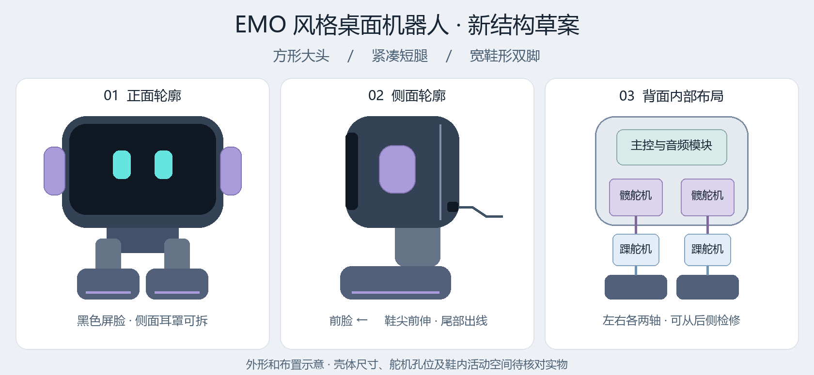

# EMO 风格结构草案

当前已从概念布局推进到 [B1 四舵机机械样机](./b1/README.md)。B1 根据用户给出的舵机图生成了 STEP 装配、可试印夹座和分件 STL。以下保留概念布局记录。

2026-11-10 用户选择类似 EMO 的方向。草案以方形大头、黑色屏脸、短腿和宽鞋形双脚为主要轮廓。侧面耳罩为可拆装饰提案。外形参照 [Living.AI 官方 EMO 页面](https://living.ai/emo/)。

| 部位 | 本版布局提案 |
| --- | --- |
| 正面 | 现有微雪 1.69 寸 LCD 竖放，外侧用黑色面框延展整块脸的轮廓。屏幕由独立托架固定。 |
| 机身 | 可拆后盖，内部用托架放 ESP32-S3 和音频模块。两颗髋舵机位于机身下方，外部供电线从后侧引出。 |
| 双脚 | 每侧暂按一颗髋舵机和一颗踝舵机布置。髋部负责水平摆转，踝部负责侧倾。宽鞋壳与承力件分开，鞋壳形状随关节活动空间调整。 |
| 维修 | 后盖打开后可接触主控和髋舵机。腿脚连接保留拆装原配摇臂和中心螺丝的工具空间。 |

草案沿用四舵机双足、短距离慢走和有线供电作为暂定目标。图中框块表示相对布置，舵机安装和运动能力需要实物验证。

先核对一侧髋部、腿和踝部能否放进所需外形，再镜像另一侧。尺寸化需要舵机两孔中心距、轴心相对壳体位置、摇臂孔位及装配后的高度，以及 LCD 总成外形和接口位置。根据这些数据确定腿间距、鞋内空间与关节限位，再出单侧关节试装件。舵机尺寸与测量基准见 [实测清单](./A1舵机与摇臂实测清单.md)。
