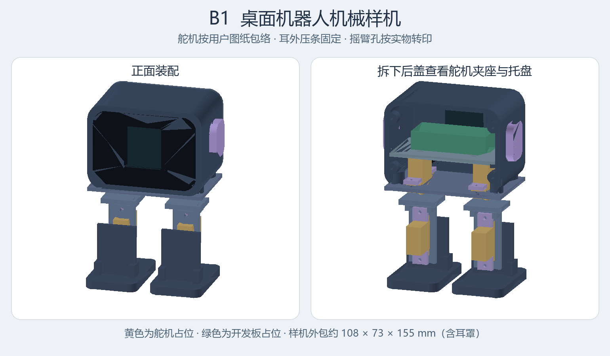

# B1 四舵机机械样机

日期 2026-11-10。B1 采用 EMO 风格的方形大头、黑色面罩和宽鞋形双脚。机身外壳、底架、后盖及短腿分别装配。模型中立姿态含耳罩外包约 **108 × 73 × 155 mm**，尺寸顺序为宽 × 深 × 高。外部插头和线缆弯曲另占空间。

## 文件与接口

- [整机 STEP](./output/EMO_B1_assembly.step)包含装配位置。黄色实体是舵机包络，绿色实体是开发板包络。
- `01` 至 `10` 为各零件的 STL，单位毫米。`04_leg_link` 和 `05_shoe` 各需两件，`06_ear_clamp` 每台八件，`09_ear_cover` 两件，反向安装即可。`07_servo_fit_coupon` 单独用于试装。
- 舵机座以用户图纸的壳体 **22.8 × 12.1 mm**、耳端跨度 **32.3 mm**、耳厚 **2.7 mm** 和底端至耳面 **21 mm** 建模。座口为 **23.6 × 12.9 mm**，对应单边 0.4 mm 设计余量。两枚夹紧螺丝在舵机耳外，孔距 39 mm 属于夹具设计值。安装方法独立于舵机原孔距。输入图见 [舵机尺寸参考](../servo-dimension-reference-2026-11-10.png)。
- 保留原配摇臂和中心螺丝。短腿顶板和鞋前立板为转印坯。可直接用实物摇臂在拆下的坯件上定位连接孔与中心螺丝访问孔。轴心的长向偏置暂按 5.5 mm 用于装配显示和几何检查，实际连接中心由原配摇臂定位。连接层厚度与垫片按试装确定。
- 正面窗口按项目里的微雪 1.69 寸 LCD 显示区留出 29.2 × 34.0 mm 开口。机身内的边角托台承托 PCB，侧边导向保留可拆空间。实物玻璃和排线位置确定后选择边缘压片或薄泡棉定位。电子托盘沿后侧导轨滑入，开发板可用绑带穿槽和绝缘垫固定。音频模块、接线分配板和插头按实物安排在余下空间。

## 最小试装顺序

1. 首批只打印 [夹座试件](./output/07_servo_fit_coupon.stl) 一件和 [压条](./output/06_ear_clamp.stl) 两件。将一颗舵机轴朝座口插入，让两个安装耳贴在座口背面的平面上，出线保持自由。
2. 将两根压条分别转向对应耳端，利用座外的 Ø3.3 通孔，用 M3 螺丝、平垫和螺母夹住耳片。试装起点可用 M3×16。按实际螺母、垫片和出线空间核对露出长度。交替拧紧至壳体无明显晃动即可。耳片弯曲、窗口卡住或两侧压不到耳片时，记录接触位置后调整模型。
3. 夹座配合后再试印一只短腿和一只鞋。用原配摇臂在短腿顶板和鞋前立板上转印孔位，将坯件取下再钻孔。按实物装好原配中心螺丝和摇臂固定件，检查从正面和底部能否伸入工具。
4. 单腿悬空，从机械中位作小幅检查，观察脚前板、鞋底、夹座螺丝和线束的净空，再复制另一侧。踝部当前由输出侧连接板承接，脚部背侧支承与实际承重需要在试件上评估。
5. 检查屏幕与开发板实际装入、后盖出线、扬声器及麦克风固定。确认单腿装配、双脚间隙与线束摆动后再安排整机打印及地面动作验证。

## 检查与复现

CadQuery 2.7 生成全部 10 个零件。STL 回读的网格边均有两个相邻三角面，整机 STEP 回读为 25 个有效实体。[检查报告](./output/检查结果.json)包含中立、左右髋镜像 ±5°、左右踝镜像 ±5° 的五个离散姿态，未发现超过 0.03 mm³ 的实体相交。检查基于名义舵机包络及预览轴心。摇臂、螺丝、线缆和装配变形仍需实物试装核对。5° 是模型抽查角，装配后的固件限位应由实物测试确定。

使用本机原 CAD 环境依次运行 `build_model.py` 和 `render_preview.py`。前者生成 STEP、STL、检查结果及预览网格，后者用网格生成装配图。修改几何时以 `build_model.py` 开头的图纸参数和设计值为入口。
